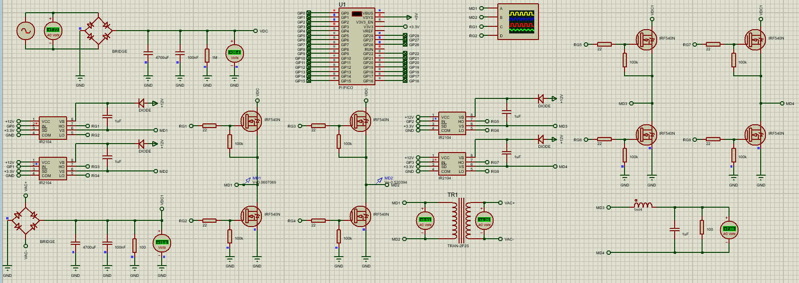
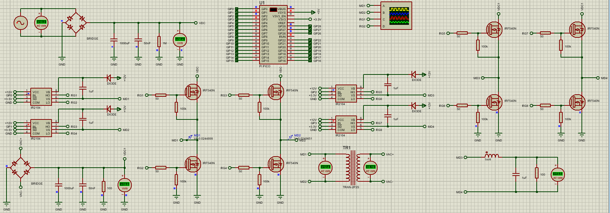
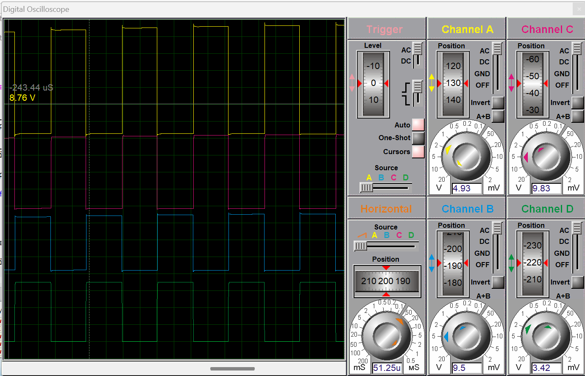
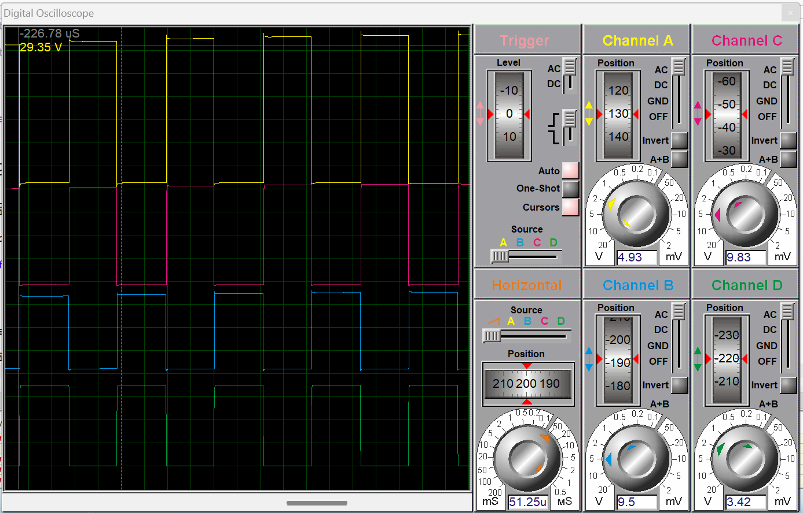

# Solid-State Transformer (SST) — Proteus & Raspberry Pi Pico

A **three-stage solid-state-transformer simulation project** built in **Proteus 8.17** using a **Raspberry Pi Pico**, four **IR2104** half-bridge drivers, eight **IRF540N** MOSFETs, a transformer model, two diode bridges, and an LC output filter.

This repository documents a developed simulation and its observed switching waveforms. The original design **target** was **24 V RMS / 50 Hz input → 12 V RMS / 50 Hz output at 20 W**, with an adjustable high-frequency switching stage. **Those final voltage, frequency, efficiency and power ratings have not all been verified under a rated load.** Images show intermediate simulated results, not a complete performance certificate.



## Architecture

```text
AC input
  │
  ▼
Stage 1: diode bridge + input DC link
  │
  ▼
Stage 2: primary MOSFET H-bridge (Q1–Q4, U1–U2)
  │
  ▼
Stage 3: transformer model (TR1)
  │
  ▼
Stage 4: secondary diode bridge + DC link
  │
  ▼
Stage 5: output MOSFET H-bridge (Q5–Q8, U3–U4)
  │
  ▼
LC output filter + resistive test load
```

The input bridge converts AC to a DC link. The primary H-bridge generates high-frequency bipolar switching, which feeds the transformer. The secondary bridge rectifies the transformed waveform, and a final full bridge with a low-pass filter is intended to synthesise a 50 Hz AC output.

## Project files

| File | Contents |
|---|---|
| [`proteus/Solid-State Transformer (SST).pdsprj`](proteus/Solid-State%20Transformer%20%28SST%29.pdsprj) | Original uploaded **self-contained Proteus project**; includes `ROOT.DSN`, graph metadata and embedded MicroPython firmware. |
| [`firmware/main_as_embedded_in_project.py`](firmware/main_as_embedded_in_project.py) | Exact Python code extracted from the uploaded Proteus project, currently configured with `SWITCH_FREQ_HZ = 5000`. |
| [`firmware/experimental_20k_reference.py`](firmware/experimental_20k_reference.py) | Separate earlier 20 kHz software-timed reference; **not a verified replacement** for the embedded project firmware. |
| [`screenshots/`](screenshots/) | Six screenshots of the schematic and switching waveforms. |
| [`docs/CONNECTIONS.md`](docs/CONNECTIONS.md) | Control-pin assignments and power-stage connection summary. |
| [`docs/TESTING_AND_LIMITATIONS.md`](docs/TESTING_AND_LIMITATIONS.md) | Reproduction notes, measurements and limitations. |

## Open in Proteus

1. Install a compatible Proteus 8.x version with **VSM MicroPython / Raspberry Pi Pico** model support (the project was saved with Proteus **8.17**).
2. Download or clone this repository.
3. Open `proteus/Solid-State Transformer (SST).pdsprj` in Proteus.
4. The uploaded project contains embedded Pico `main.py` under `FIRMWARE/PI_PICO_1/`.
5. Inspect the DC supplies and circuit values in the project before running; review the simulation warnings in [Testing and limitations](docs/TESTING_AND_LIMITATIONS.md).
6. Use Proteus graph/oscilloscope tools to measure switching and output waveforms. Avoid assuming the displayed AC voltmeter indicates the true RMS fundamental for nonsinusoidal waveforms.

## Adjust the requested frequency

In the **embedded firmware** edit:

```python
SWITCH_FREQ_HZ = 5000  # example: 5000, 10000, 20000
OUTPUT_FREQ_HZ = 50
MODULATION_INDEX = 0.80
```

The firmware switches GPIOs using Python calls and `time.sleep_us()`. Thus **the requested frequency is not guaranteed to equal the actual waveform frequency**. Hardware-timed PWM/PIO would be necessary for reliable physical implementation; check actual measured periods in Proteus.

## GPIO mapping

| Pico GPIO | IR2104 `IN` | Role |
|---|---|---|
| GP0 | U1 pin 2 | Primary left leg |
| GP1 | U2 pin 2 | Primary right leg |
| GP2 | U3 pin 2 | Output left leg SPWM |
| GP3 | U4 pin 2 | Output right leg SPWM |

See [connections](docs/CONNECTIONS.md) for further details.

## Screenshot gallery

**Main circuit & simulated meter readings:**



**Switching signals shown on the Proteus oscilloscope:**





The waveforms are representative of the measured switching nodes; they do not substitute for separate verification of input and output ripple, secondary DC voltage, gate drive, output voltage THD, or output load performance.

## Verification status

- **Demonstrated:** An integrated multi-stage Proteus schematic, Pico-controlled switching activity, transformer/rectifier stages, and screenshots of waveforms.
- **Not independently verified:** Sustained 20 W output; accurate 12 V RMS at 50 Hz under full load; conversion efficiency; galvanic isolation; overcurrent protection; hardware switching safety; and convergence across all modes.
- **Important isolation caveat:** This simplified simulation directly shares Pico/driver grounds across the power-conversion stages. Such connections **bypass galvanic isolation**, despite the transformer. Do **not** interpret the project as a hardware-ready isolated SST.

## Safety / scope

**Educational simulation only.** It is not a validated or certified electrical power converter. Physical construction requires isolation design, gate-drive timing, appropriately rated magnetic components, protection, thermal analysis, PCB clearance/creepage, and safe power testing. Do not connect this schematic directly to mains power.

## Author

Proteus project and captures supplied by repository owner. README and documentation prepared as a repository handoff.
